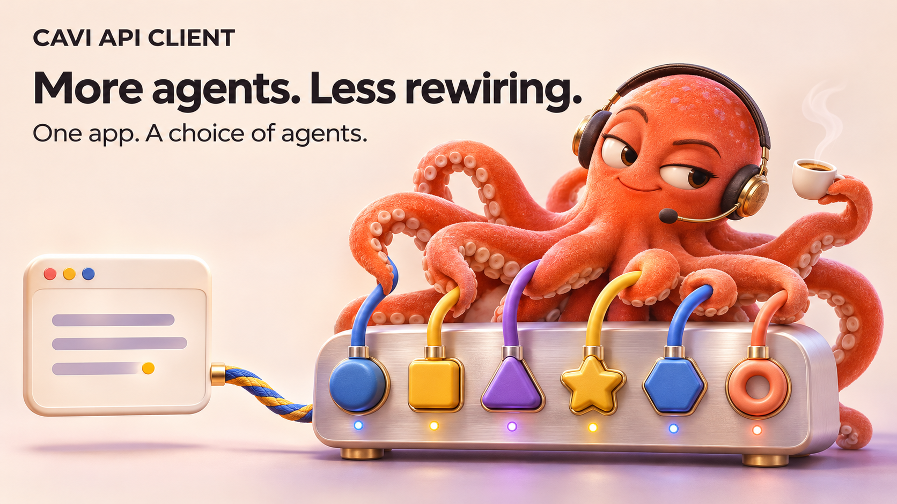

<h1 align="center">
  
</h1>

[](https://www.npmjs.com/package/@cavi-ai/api-client)
[](https://www.npmjs.com/package/@cavi-ai/api-client)
[](https://pypi.org/project/cavi-api-client/)
[](https://pypi.org/project/cavi-api-client/)
[](LICENSE)



Give your users a choice of agent without rebuilding the app around each backend.

Cavi API Client brings shared run, status and stream contracts to applications using multiple agent runtimes. Build your user experience around those contracts while adapters handle the backend's HTTP, SSE or WebSocket connection.

## Keep the app. Add the runtime.

Your application consumes run IDs, statuses, text, token usage and stream events. The client handles the provider-specific mapping.

- **One progress experience.** Handle text, tool activity, approvals and terminal events through shared stream contracts.
- **Background work that stays identifiable.** Retain run IDs for retrieval, bounded observation and explicit cancellation.
- **Batches you can collect.** Correlate requests by `customId` and handle each item's result.
- **Features that match the backend.** Consult capabilities before offering runtime-specific tools; unsupported operations return structured gaps.

Adapters cover Claude, Codex, AGY, OpenCode, Hermes and OpenClaw. Connect the runtimes and credentials your application uses; models, native tools and persistence stay with their providers. See [provider compatibility](docs/guides/provider-compatibility.md).

## What are you building?

| Your application | Use the client for |
| --- | --- |
| An assistant with a runtime selector | Shared progress, tool activity, approvals and outcomes |
| A service that starts background jobs | Run tracking, retrieval, bounded waits and cancellation |
| A batch processing pipeline | Request correlation and per-item results |
| A gateway dashboard | Available sessions, models, usage, tasks and workspace access |

## Start with your workflow

1. Install the [TypeScript or Python SDK](#typescript-and-python-sdks).
2. [Configure the runtime you want to use](https://github.com/cavi-ai/cavi-api-client/blob/main/docs/api-client/source/pages/guides/providers.md).
3. Follow the [first-response guide](https://github.com/cavi-ai/cavi-api-client/blob/main/docs/api-client/source/pages/introduction/quickstart.md), then add the workflow your application needs.

Keep credentials in your server configuration. Reuse a client within its credential/configuration scope and dispose of it when its owner shuts down.

## Runs, streams and background jobs

- [Streaming](https://github.com/cavi-ai/cavi-api-client/blob/main/docs/api-client/source/pages/guides/streaming.md): render progress and handle terminal events.
- [Background requests](https://github.com/cavi-ai/cavi-api-client/blob/main/docs/api-client/source/pages/guides/requests.md): retain run identity and bound local waits.
- [Owned background runs](https://github.com/cavi-ai/cavi-api-client/blob/main/docs/guides/owned-background-runs.md): authorize retrieval and explicit cancellation in your application.
- [Batches](https://github.com/cavi-ai/cavi-api-client/blob/main/docs/api-client/source/pages/guides/batching.md): submit work and collect per-item results.
- [Run results](https://github.com/cavi-ai/cavi-api-client/blob/main/docs/guides/run-results.md): turn completed work into a usable answer with completion helpers.
- [Errors](https://github.com/cavi-ai/cavi-api-client/blob/main/docs/api-client/source/pages/guides/errors.md): handle structured gaps and typed execution failures.
- [HTTP integration](https://github.com/cavi-ai/cavi-api-client/blob/main/docs/api-client/source/pages/guides/http.md): expose the workflow through an application endpoint.

Prefer `createApiClient` for TypeScript applications. Its `CapabilityClient` returns `CapabilityResult<T>`. Adapter authors can use the raw `RuntimeClient` contract.

## Project references

[Migration](MIGRATION.md) · [Changelog](CHANGELOG.md) ·
[Architecture](ARCHITECTURE.md) · [Contributing](CONTRIBUTING.md) ·
[Security](SECURITY.md)

[Full documentation](https://cavi-ai.xyz/docs/api-client) ·
[Documentation hosting contract](docs/api-client/CONSUMER.md)

The npm package includes an offline documentation snapshot at `docs/api-client/v<documented version>`; see the [consumer contract](docs/api-client/CONSUMER.md).

## TypeScript and Python SDKs

### TypeScript

```sh
npm install @cavi-ai/api-client
```

Node.js 20 or later. The package is ESM, includes TypeScript declarations and has no runtime dependencies. React integration is optional.

[TypeScript quickstart](https://github.com/cavi-ai/cavi-api-client/blob/main/docs/api-client/source/pages/introduction/quickstart.md) ·
[Provider setup](https://github.com/cavi-ai/cavi-api-client/blob/main/docs/api-client/source/pages/guides/providers.md)

### Python

```sh
pip install cavi-api-client
```

Python 3.11 or later. Import the native client from `cavi_runtime`. HTTPX handles native connections; WebSocket providers have their own optional dependency.

[Python SDK guide](https://github.com/cavi-ai/cavi-api-client/blob/main/docs/api-client/source/pages/guides/python.md) ·
[Runtime lifecycle and bounded polling](docs/guides/python-runtime.md)

## License

[MIT](LICENSE)
